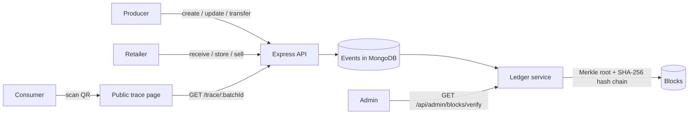

<div align="center">

# 🌱 SkeoTrace

**Farm-to-fork food traceability with a tamper-evident ledger and QR codes.**

Producers record every step of a batch's journey, retailers receive and sell it, and consumers scan a QR code to see where their food came from and verify that the record hasn't been altered.

[](LICENSE)
[](https://www.typescriptlang.org)
[](https://react.dev)
[](https://expressjs.com)
[](https://www.mongodb.com)
[](https://skeo-trace.vercel.app/)
[](CONTRIBUTING.md)

[Live demo](https://skeo-trace.vercel.app/) · [Quick start](#quick-start) · [How it works](#how-it-works) · [API](#api) · [Roadmap](#roadmap) · [Contributing](#contributing)

</div>

---

## Why

Labels like "organic" and "locally grown" are hard for shoppers to check. SkeoTrace gives every batch of produce a public, verifiable history: who grew it, when it moved, where it was stored and when it was sold. Each event is hash-linked, so any later edit is detectable.

## Features

- **Batch lifecycle:** producers create batches, update them and transfer them; retailers receive, store and sell them.
- **Tamper-evident ledger:** events are grouped into blocks with a Merkle root, and each block's SHA-256 hash includes the previous block's hash. Admins can verify the whole chain with one request.
- **QR codes:** every batch gets a QR code that links to its public trace page, so no app or login is needed to scan it.
- **Role-based dashboards** for producers, retailers, consumers and admins, with JWT authentication and role-based access control on every route.
- **Audit view:** admins can browse blocks, users and the audit trail.

## Live demo

Try it at **<https://skeo-trace.vercel.app>** (the API runs on a free Render instance and may take about 30 seconds to wake up).

| Role | Email | Password |
| --- | --- | --- |
| Producer | `producer@demo.com` | `password123` |
| Retailer | `retailer@demo.com` | `password123` |
| Consumer | `consumer@demo.com` | `password123` |
| Admin | `admin@demo.com` | `password123` |

## How it works



The ledger (`backend/src/services/blockchain.ts`) is a self-contained hash chain stored in MongoDB: block hash = SHA-256(index + timestamp + previous hash + Merkle root of the block's events). It runs anywhere MongoDB does. Anchoring the chain to a public or permissioned blockchain (such as Hyperledger Fabric) is on the [roadmap](#roadmap).

## Quick start

**Requirements:** Node.js 18+ and MongoDB (local, or a free [Atlas](https://www.mongodb.com/atlas) cluster).

```bash
git clone https://github.com/skdas20/SkeoTrace.git
cd SkeoTrace
npm install            # installs concurrently
npm run install-all    # backend + frontend dependencies
```

**Backend:** create `backend/.env` from the example:

```bash
cp backend/.env.example backend/.env
```

| Variable | Example | Purpose |
| --- | --- | --- |
| `MONGO_URI` | `mongodb://localhost:27017/organic_traceability` | Database connection |
| `JWT_SECRET` | a long random string | Signs login tokens |
| `PORT` | `5000` | API port |
| `FRONTEND_PUBLIC_URL` | `http://localhost:3000` | Base URL encoded in QR codes |

**Frontend:** create `frontend/.env` with `VITE_API_URL=http://localhost:5000`.

**Seed demo users and run:**

```bash
npm run seed                 # creates admin, producer, retailer and consumer accounts
cd backend && npm run dev    # API on http://localhost:5000
cd frontend && npm run dev   # web app on http://localhost:3000 (in a second terminal)
```

Seeded local accounts:

| Role | Email | Password |
| --- | --- | --- |
| Admin | `admin@trace.local` | `Admin@123` |
| Producer | `prod@trace.local` | `Prod@123` |
| Retailer | `shop@trace.local` | `Retail@123` |
| Consumer | `cons@trace.local` | `Cons@123` |

## API

All routes are mounted under `/api`. Authenticated routes need `Authorization: Bearer <token>` from `POST /api/auth/login`.

| Area | Endpoints |
| --- | --- |
| Auth | `POST /api/auth/register`, `POST /api/auth/login`, `GET /api/auth/profile` |
| Producer | `POST /api/producer/batches`, `PATCH /api/producer/batches/:id`, `POST /api/producer/batches/:id/transfer`, `GET /api/producer/batches` |
| Retailer | `POST /api/retailer/batches/:id/receive`, `…/store`, `…/sell`, `GET /api/retailer/batches`, `GET /api/retailer/batches/search` |
| Public | `GET /api/public/trace/:batchId`, `GET /api/public/qrcode/:batchId` |
| Admin | `GET /api/admin/users`, `GET /api/admin/blocks`, `GET /api/admin/blocks/verify`, `GET /api/admin/audit` |
| Health | `GET /api/health` |

See `backend/src/routes/` for request bodies and the exact mount prefixes.

## Project structure

```
backend/     Express + TypeScript API
  src/models/      Batch, Event, Block, User (Mongoose)
  src/routes/      auth, producer, retailer, public, admin
  src/services/    batch logic and the hash-chain ledger
  src/utils/       SHA-256, Merkle tree, QR code helpers
  scripts/seed.ts  demo users
frontend/    React + Vite + Tailwind web app (dashboards, public trace page)
data/        Feasibility report, software requirements and design documents (PDF)
```

## Roadmap

- [ ] Anchor block hashes to a public chain or Hyperledger Fabric
- [ ] Certifier role: upload and verify organic certificates
- [ ] Distributor and processor roles: split and merge batches, shipping events
- [ ] Mobile-friendly QR scanner page with camera support
- [ ] Automated tests for the ledger and the batch lifecycle, plus CI
- [ ] Docker Compose setup (API, web app and MongoDB)
- [ ] Internationalisation for farmers and consumers in different regions

## Contributing

Backend, frontend, documentation and supply-chain domain knowledge are all welcome. Read [CONTRIBUTING.md](CONTRIBUTING.md) and look for issues labelled [`good first issue`](https://github.com/skdas20/SkeoTrace/labels/good%20first%20issue).

If you like the project, **a ⭐ helps others find it**.

## License

[MIT](LICENSE) © Sumit Kumar Das
